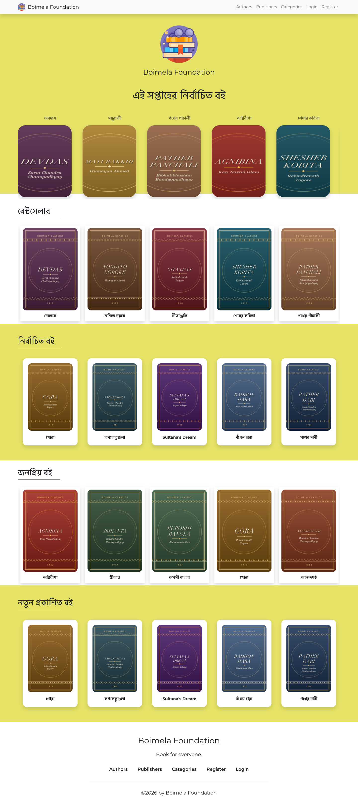
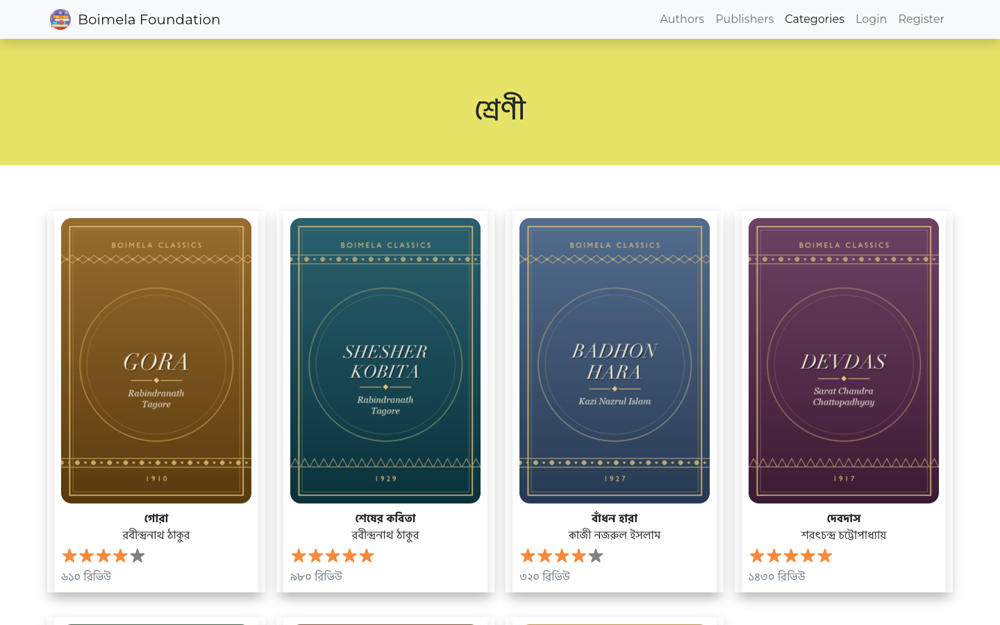
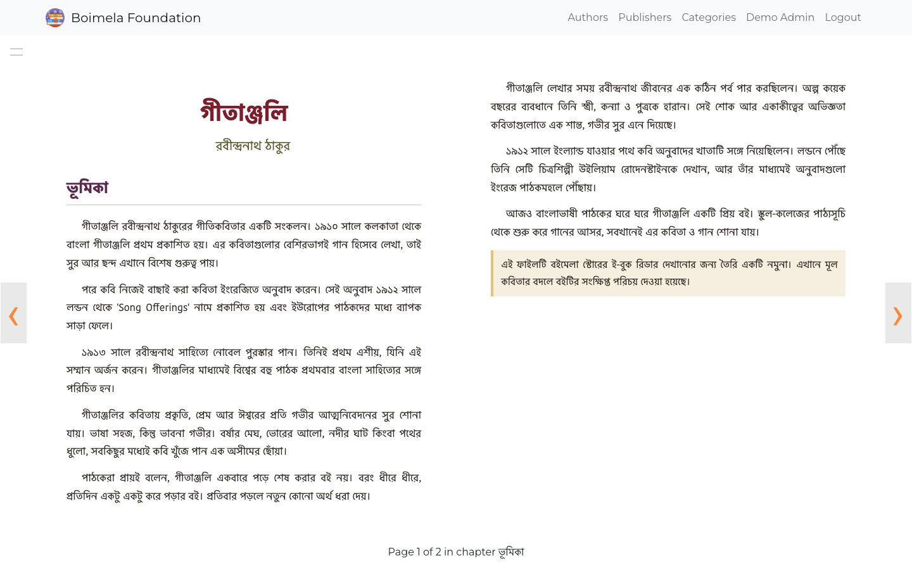
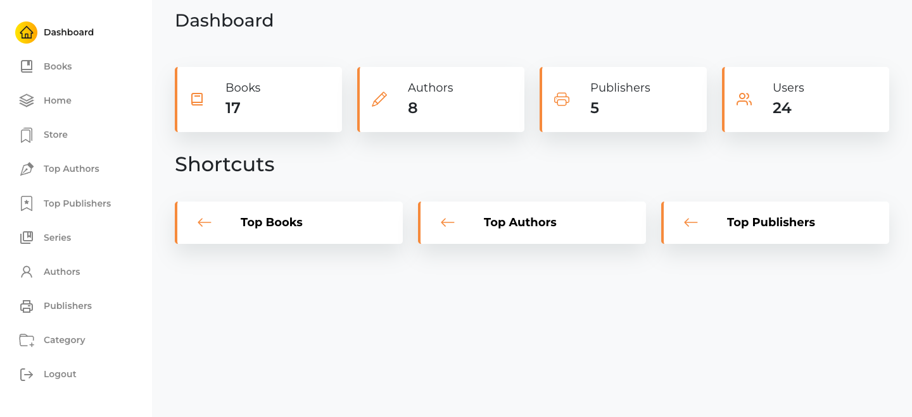
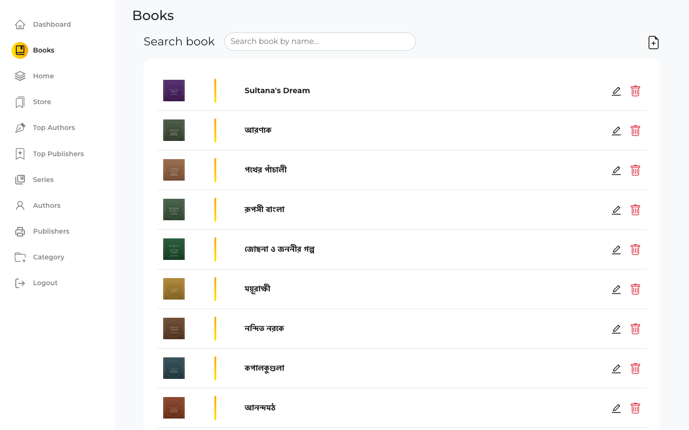
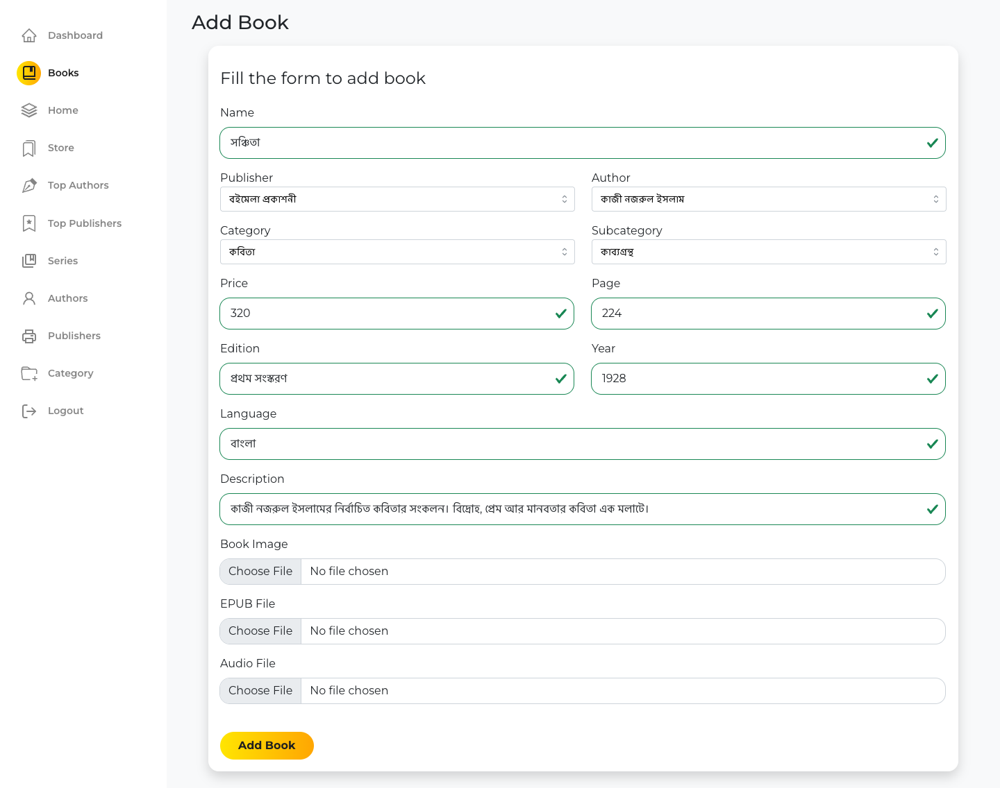
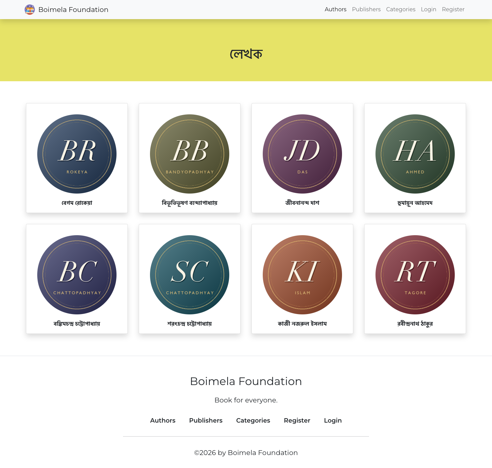

# Boimela Store

Web storefront and admin panel for **Boimela**, a Bangla e-book platform. Readers browse books by category, author and publisher and read EPUB books right in the browser. Admins manage the whole catalog from a dashboard.

Boimela started as my B.Sc. thesis at RUET ([thesis book](https://drive.google.com/file/d/149zs7FkKbIcUSxSqJXVpQD0_5V0MFOzO/view?usp=sharing)). This repository is the web front end; the other parts are:

- [Boimela](https://github.com/Khalid-Syfullah/Boimela): Android EPUB3 reader app (Java, MVVM)
- [Boimela-Backend](https://github.com/Khalid-Syfullah/Boimela-Backend): Node.js REST API that this store talks to

## Screenshots

Screens from a local run with sample data: classic Bangla titles, generated covers and a short demo EPUB.

### Storefront

<table>
  <tr>
    <td align="center" valign="top" rowspan="3">
      <br>
      <b>Home</b><br><sub>Featured carousel, best sellers, picks, popular and new books</sub>
    </td>
    <td align="center" valign="top">
      <br>
      <b>Category</b><br><sub>Novels with ratings and Bangla review counts</sub>
    </td>
  </tr>
  <tr>
    <td align="center" valign="top">
      <br>
      <b>Book page</b><br><sub>Cover, author, edition, rating and Read eBook</sub>
    </td>
  </tr>
  <tr>
    <td align="center" valign="top">
      <br>
      <b>EPUB reader</b><br><sub>Two-page spread with chapter progress</sub>
    </td>
  </tr>
</table>

### Admin panel

<table>
  <tr>
    <td align="center" valign="top">
      <br>
      <b>Dashboard</b><br><sub>Counts of books, authors, publishers and users</sub>
    </td>
    <td align="center" valign="top">
      <br>
      <b>Books</b><br><sub>Search, covers, edit and delete</sub>
    </td>
  </tr>
  <tr>
    <td align="center" valign="top">
      <br>
      <b>Add a book</b><br><sub>Details plus cover, EPUB and audio uploads</sub>
    </td>
    <td align="center" valign="top">
      <br>
      <b>Authors (storefront)</b><br><sub>Author grid</sub>
    </td>
  </tr>
</table>

## Features

### Storefront

- Landing page with a hero banner and carousels for best sellers, our picks, popular books and new arrivals
- Browse pages for categories, authors and publishers, each with its own detail page, plus a page for every book
- Bangla interface: Bangla shelf and collection names (জীবনী, সায়েন্স ফিকশন, বেস্টসেলার …) and Bangla numerals
- In-browser EPUB reader with table of contents and a "page X of Y in chapter" indicator, for signed-in users

### Admin panel

- Sign in at `/admin/login`; every admin route is protected
- Dashboard with counts of books, authors, publishers and users, and the top books, authors and publishers
- Add, edit and list books (cover image, EPUB file and audio file), authors, publishers, categories and sub-categories, series, collections and featured lists
- Pick the top authors and top publishers shown on the store
- JWT access tokens with automatic refresh: a 401 response refreshes the token and retries, or signs the admin out

## Tech stack

| Area | Tools |
| --- | --- |
| UI | React 17 (Create React App), React Router 6 |
| State and data | Redux, Redux Thunk, Axios |
| Components and styling | Mantine, React Bootstrap, Bootstrap 5, SCSS modules |
| Forms | Formik, Yup, Mantine Form |
| Reading | react-reader (epub.js) |
| Extras | react-slick carousels, react-toastify notifications, Moment |

## Project structure

```
src/
├─ views/        pages (storefront, reader and admin screens)
├─ components/   reusable sections, lists, cards and forms
├─ actions/      API calls as Redux Thunk actions
├─ reducers/     Redux state for auth, books, authors, publishers, categories, series, collections
├─ store/        Redux store
├─ constants/    API base URL, shelves and collections
└─ utils/        auth token helpers, protected routes, Bangla numerals
```

## Getting started

You need Node.js 16 (the project uses `node-sass` 7, which does not build on newer Node versions).

```bash
npm install
npm start
```

The store opens at <http://localhost:3000>.

The API address is set in `src/constants/URL.js`. With `PROD = true` the store uses the live API at `https://api.boimelafoundation.com`; set it to `false` to use a local [Boimela-Backend](https://github.com/Khalid-Syfullah/Boimela-Backend) on `http://localhost:5002`.

To make a production build in `build/`:

```bash
npm run build
```

## Author

**Md Khalid Syfullah**: [GitHub](https://github.com/Khalid-Syfullah) · [LinkedIn](https://linkedin.com/in/khalid-syfullah)
